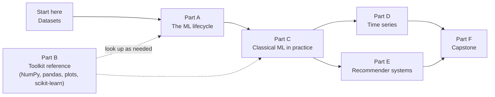

# Learning Path

The course is built around **one story told with real data**, then widened with two specialised tracks. Work through the parts in order. Each part says what you should be able to do before moving on.

!!! info "This is a work in progress"
    The course is being rebuilt. **Available** means the page exists and runs. **Planned** means it is on the roadmap and not written yet. This table is updated as pages land, so the status is always true.

## Start here

| Page | Status | You are ready to move on when you can… |
|---|---|---|
| [How to use this site](how-to-use.md) | Available | run a page on Colab or locally |
| [The Datasets](datasets.ipynb) | Available | load every dataset and name two quality problems in each |

## Part A: The ML project lifecycle *(retail case study)*

From a business question to a monitored model, in the order real projects go.

| Step | Topic | Status |
|---|---|---|
| 1 | [Problem framing and success metrics](../lifecycle/01-problem-framing.ipynb) | Available |
| 2 | [Data acquisition and validation](../lifecycle/02-data-validation.ipynb) | Available |
| 3 | [Cleaning](../lifecycle/03-cleaning.ipynb) | Available |
| 4 | [Exploratory analysis, with interpretation](../lifecycle/04-eda.ipynb) | Available |
| 5 | [Splitting strategy: random, grouped, time-based](../lifecycle/05-splitting.ipynb) | Available |
| 6 | [Baselines](../lifecycle/06-baselines.ipynb) | Available |
| 7 | [Feature engineering](../lifecycle/07-features.ipynb) | Available |
| 8 | [Modelling](../lifecycle/08-modelling.ipynb) | Available |
| 9 | [Evaluation and error analysis](../lifecycle/09-evaluation.ipynb) | Available |
| 10 | [Tuning and experiment tracking](../lifecycle/10-tuning.ipynb) | Available |
| 11 | [Interpretation and fairness](../lifecycle/11-interpretation.ipynb) | Available |
| 12 | [Packaging and serving](../lifecycle/12-serving.ipynb) | Available |
| 13 | [Monitoring and drift](../lifecycle/13-monitoring.ipynb) | Available |
| 14 | [Reproducibility and project hygiene](../lifecycle/14-reproducibility.ipynb) | Available |

**Ready to move on when** you can take a raw table and a business question and produce an evaluated, honestly-split model, and explain every decision you made on the way.

## Part B: Toolkit reference

Look-up pages for the libraries. Use them whenever a syntax detail slips your mind.

| Library | Page | Status |
|---|---|---|
| NumPy | [Arrays and indexing](../toolkit/numpy-arrays.ipynb) · [Vectorisation, broadcasting, linear algebra](../toolkit/numpy-vectorisation.ipynb) | Available (real data, with exercises) |
| pandas | [Series, DataFrames and selection](../toolkit/pandas-basics.ipynb) · [Cleaning and types](../toolkit/pandas-cleaning.ipynb) · [Grouping, merging and reshaping](../toolkit/pandas-grouping.ipynb) | Available (real data, with exercises) |
| Plotting | [Matplotlib](../toolkit/matplotlib.ipynb) · [Seaborn](../toolkit/seaborn.ipynb) | Available (real data, with exercises) |
| scikit-learn | [API](../libraries/scikit-learn/index.md) · [Preprocessing](../libraries/scikit-learn/preprocessing.md) · [Pipelines](../libraries/scikit-learn/pipelines.md) · [Models](../libraries/scikit-learn/models.md) · [Evaluation](../libraries/scikit-learn/evaluation-tuning.md) | Available (reference style, being upgraded) |
| Workflows | [EDA checklist](../workflows/eda-checklist.md) · [End-to-end template](../workflows/end-to-end-ml.md) | Available |
| Debugging | [Common mistakes](../resources/common-errors.md) | Available |

!!! note
    The existing reference pages use small invented examples. They are accurate, but they are being rewritten on the real datasets, with outputs and exercises.

## Part C: Classical ML in practice

Regularised linear models · trees and boosting · distance-based models · imbalanced data and thresholds · clustering and dimensionality reduction. **Status: planned.**

**Ready to move on when** you can choose a model family for a problem, say what will go wrong with it on this data, and verify that it did not.

## Part D: Time series *(NYC taxi)*

Time-indexed data handling · decomposition and stationarity · baselines · ETS/ARIMA · machine learning on lag features · **backtesting** · forecast metrics and intervals · holidays, regime change and drift. **Status: planned.**

**Ready to move on when** you can build a forecast, backtest it without leaking the future, and explain how it would fail.

## Part E: Recommender systems *(MovieLens and retail)*

Explicit vs implicit feedback · popularity and neighbourhood baselines · matrix factorisation · **ranking metrics and correct splitting** · cold start · beyond accuracy. **Status: planned.**

**Ready to move on when** you can build a recommender, evaluate it with ranking metrics on a leak-free split, and say what it recommends *too much* of.

## Part F: Capstone

Choose a question, pick data, and take it through the whole lifecycle with a written justification. **Status: planned.**
