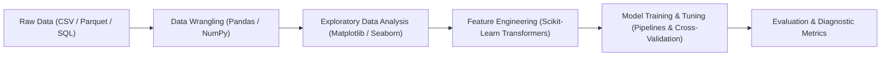

# Machine Learning Practice (MLP)

Welcome to the **Machine Learning Practice** course reference portal. This site is designed as a fast, searchable, and code-first reference handbook for students working with data and building machine learning systems in Python.

Rather than memorizing syntax or searching scattered forums, use this portal to quickly look up library APIs, idiomatic code patterns, practical workflows, and real-world debugging tips.

!!! tip "New here?"
    Start with [How to use this site](getting-started/how-to-use.md), then meet the [real-world datasets](getting-started/datasets.ipynb) the whole course is built on. The [learning path](getting-started/learning-path.md) shows the order and what is coming.

---

## 🧭 Course Roadmap & Library Ecosystem

---

## 📚 Core Documentation Modules

  

    <h3><a href="libraries/numpy/">⚡ NumPy Reference</a></h3>
    
High-performance n-dimensional array computing, memory layouts, vectorized arithmetic, broadcasting mechanics, and linear algebra operations.

  

  

    <h3><a href="libraries/pandas/">🐼 Pandas Reference</a></h3>
    
DataFrames and Series, bulletproof data cleaning, handling missing values, grouped aggregations, merges, and indexing without warnings.

  

  

    <h3><a href="libraries/visualization/matplotlib/">📊 Data Visualization</a></h3>
    
Mastering Matplotlib's Object-Oriented interface alongside Seaborn's high-level statistical plots (distributions, pairplots, correlation heatmaps).

  

  

    <h3><a href="libraries/scikit-learn/">⚙️ Scikit-Learn API</a></h3>
    
Consistent API design (<code>fit</code>, <code>transform</code>, <code>predict</code>), robust ColumnTransformers, Pipelines, and leakage-free cross-validation.

  

  

    <h3><a href="workflows/eda-checklist/">📋 Practical Workflows</a></h3>
    
Actionable checklists for Exploratory Data Analysis (EDA) and a complete end-to-end tabular machine learning starter template.

  

  

    <h3><a href="resources/common-errors/">⚠️ Student Debugging Guide</a></h3>
    
Solutions to the top 10 most common runtime errors and logical pitfalls students encounter during machine learning lab sessions.

  

---

## 💡 How to Use This Website

- **Instant Search:** Press <kbd>s</kbd> or <kbd>/</kbd> anywhere on this site to activate the instant search bar. Type function names (e.g. `StandardScaler`, `groupby`, `train_test_split`) to jump straight to examples.
- **Copy Code:** Click the copy icon in the upper-right corner of any code block to copy ready-to-run snippets.
- **Side-by-Side Comparisons:** Look for tabbed code blocks illustrating differences between techniques (e.g. `StandardScaler` vs `MinMaxScaler`).
- **Best Practice Alerts:** Pay special attention to callout boxes labeled `WARNING` or `TIP` to avoid common exam and project mistakes such as data leakage.
