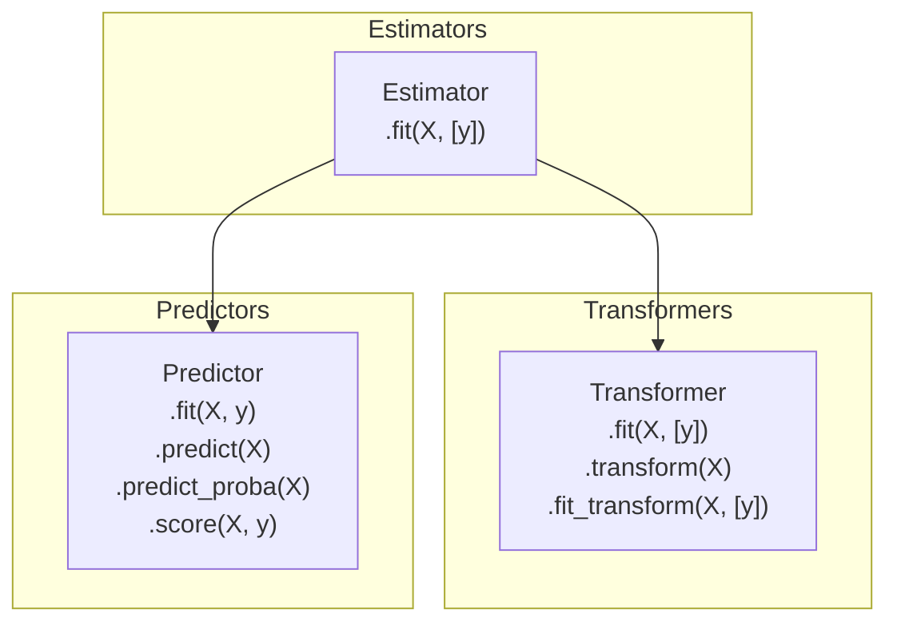

# Scikit-Learn: The Estimator API Design

[Scikit-learn](https://scikit-learn.org/) is the industry-standard library for classical machine learning in Python. Its enduring success is built upon a uniform, elegant, and predictable object-oriented API design.

---

## 🏛️ The Three API Pillars

Every Scikit-Learn class belongs to one or more of these core interfaces:



---

## 1. Estimators (`.fit()`)
Estimators learn parameters from data.
- **Method:** `estimator.fit(X, y=None)`
- **Behavior:** Calculates internal state and stores learned parameters with a **trailing underscore** (e.g. `model.coef_`, `scaler.mean_`, `imputer.statistics_`).

```python
from sklearn.linear_model import LinearRegression

reg = LinearRegression()
reg.fit(X_train, y_train)

# Learned attributes have trailing underscores:
print("Learned Weights:", reg.coef_)
print("Learned Bias:   ", reg.intercept_)
```

---

## 2. Transformers (`.transform()`, `.fit_transform()`)
Transformers modify datasets (imputers, scalers, encoders, PCA).
- **`fit(X)`**: Learns transformation statistics (e.g. mean and standard deviation).
- **`transform(X)`**: Applies the learned transformation to input data.
- **`fit_transform(X)`**: Highly optimized single pass to fit and transform simultaneously.

```python
from sklearn.preprocessing import StandardScaler

scaler = StandardScaler()
# Fit on training data and transform it
X_train_scaled = scaler.fit_transform(X_train)

# ONLY transform test data (using training mean and std!)
X_test_scaled = scaler.transform(X_test)
```

---

## 3. Predictors (`.predict()`, `.predict_proba()`)
Predictors make inferences on unseen feature matrices.
- **`predict(X)`**: Returns predicted labels (classification) or target values (regression).
- **`predict_proba(X)`**: Returns probability distribution over classes $[P(y=0), P(y=1)]$.
- **`score(X, y)`**: Evaluates accuracy (classification) or $R^2$ coefficient of determination (regression).

```python
from sklearn.linear_model import LogisticRegression

clf = LogisticRegression()
clf.fit(X_train, y_train)

y_pred = clf.predict(X_test)
probabilities = clf.predict_proba(X_test) # shape: (N, n_classes)
acc = clf.score(X_test, y_test)
```

---

## ⚠️ The Cardinal Rule: Training vs Testing Isolation

!!! danger "Never Fit on the Entire Dataset or Test Data"
    ```python
    # ❌ INCORRECT (Data Leakage! Scaler learns test distribution):
    scaler = StandardScaler()
    X_scaled = scaler.fit_transform(X)   # <--- LEAK!
    X_train, X_test, y_train, y_test = train_test_split(X_scaled, y)

    # ✅ CORRECT:
    X_train, X_test, y_train, y_test = train_test_split(X, y, random_state=42)
    scaler = StandardScaler()
    X_train_scaled = scaler.fit_transform(X_train)
    X_test_scaled  = scaler.transform(X_test)
    ```
