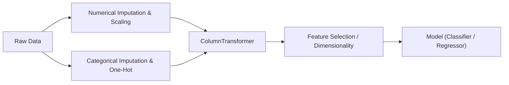

# Scikit-Learn: Pipelines & ColumnTransformers

Real-world datasets contain a mix of numerical and categorical columns, each requiring different preprocessing steps before reaching a machine learning model. `ColumnTransformer` and `Pipeline` unite these steps into a single, leak-free object.

---

## 🛡️ Why Use Pipelines?



### The Peril of Manual Preprocessing:
If you preprocess features before cross-validation, your validation folds leak data into the training fold calculations (such as global means or category distributions).

With a `Pipeline`:
1. `cross_val_score()` and `GridSearchCV` automatically re-fit the transformers **strictly on the training folds**.
2. Deploying a model is as simple as calling `pipeline.predict(raw_input_df)`.

---

## 🧩 Building a Modular Tabular Pipeline

Here is the industry-standard architecture for tabular data:

```python
import pandas as pd
from sklearn.model_selection import train_test_split
from sklearn.compose import ColumnTransformer
from sklearn.pipeline import Pipeline
from sklearn.impute import SimpleImputer
from sklearn.preprocessing import StandardScaler, OneHotEncoder
from sklearn.ensemble import RandomForestClassifier

# 1. Separate features and target
X = df.drop(columns=["target"])
y = df["target"]

X_train, X_test, y_train, y_test = train_test_split(
    X, y, test_size=0.2, random_state=42, stratify=y
)

# 2. Automatically identify feature columns
numeric_features = X.select_dtypes(include=["int64", "float64"]).columns.tolist()
categorical_features = X.select_dtypes(include=["object", "category"]).columns.tolist()

# 3. Create sub-pipelines for each data type
numeric_transformer = Pipeline(steps=[
    ("imputer", SimpleImputer(strategy="median")),
    ("scaler", StandardScaler())
])

categorical_transformer = Pipeline(steps=[
    ("imputer", SimpleImputer(strategy="most_frequent")),
    ("encoder", OneHotEncoder(handle_unknown="ignore", sparse_output=False))
])

# 4. Combine into a ColumnTransformer
preprocessor = ColumnTransformer(
    transformers=[
        ("num", numeric_transformer, numeric_features),
        ("cat", categorical_transformer, categorical_features)
    ],
    remainder="drop"  # Drop any columns not explicitly specified
)

# 5. Assemble final End-to-End Pipeline
full_pipeline = Pipeline(steps=[
    ("preprocessor", preprocessor),
    ("classifier", RandomForestClassifier(n_estimators=100, random_state=42))
])

# 6. Fit & Evaluate
full_pipeline.fit(X_train, y_train)
score = full_pipeline.score(X_test, y_test)
print(f"Test Accuracy: {score:.4f}")
```

---

## 🔍 Inspecting Pipeline Steps & Feature Names

```python
# Access a specific step by name
trained_rf = full_pipeline.named_steps["classifier"]
print("Tree count:", len(trained_rf.estimators_))

# Extract feature names after ColumnTransformer encoding
preprocessor_fitted = full_pipeline.named_steps["preprocessor"]
transformed_feature_names = preprocessor_fitted.get_feature_names_out()
print("Total engineered features:", len(transformed_feature_names))
```

---

## ⚙️ Hyperparameter Tuning Pipelines with `GridSearchCV`

To tune parameters within nested steps, use the double-underscore syntax: `<step_name>__<param_name>`:

```python
from sklearn.model_selection import GridSearchCV

param_grid = {
    "preprocessor__num__imputer__strategy": ["mean", "median"],
    "classifier__n_estimators": [100, 200],
    "classifier__max_depth": [5, 10, None]
}

grid_search = GridSearchCV(
    estimator=full_pipeline,
    param_grid=param_grid,
    cv=5,
    scoring="f1_macro",
    n_jobs=-1
)

grid_search.fit(X_train, y_train)

print("Best Parameters:", grid_search.best_params_)
print("Best CV Score:  ", grid_search.best_score_)
```
