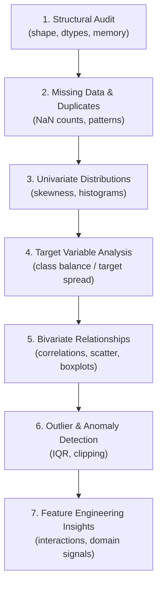

# Exploratory Data Analysis (EDA) Checklist

!!! info "Superseded by a worked example"
    This checklist is kept as a quick reference. For the same ideas applied to a real dataset, with the traps found in practice, read [Exploratory Analysis](../lifecycle/04-eda.ipynb) and [Data Acquisition and Validation](../lifecycle/02-data-validation.ipynb) in the lifecycle chapter.


Before training any model, follow this rigorous step-by-step EDA protocol to understand distributions, relationships, and data quality issues.

---

## 📋 The 7-Step EDA Protocol



---

## Step 1: Structural Audit
Inspect table dimensions, column naming conventions, and data type alignments:

```python
import pandas as pd

# Check shape and preview top rows
print("Dimensions:", df.shape)
df.head(3)

# Verify column names (strip whitespace and convert to lower snake_case)
df.columns = df.columns.str.strip().str.lower().str.replace(" ", "_")

# Audit data types
df.info()
```

---

## Step 2: Missing Values & Duplicates
Identify the pattern and proportion of missingness:

```python
# Check total duplicate rows
print("Duplicate rows:", df.duplicated().sum())

# Missing value summary
missing = df.isna().sum()
missing_percent = (df.isna().mean() * 100).round(2)
missing_table = pd.concat([missing, missing_percent], axis=1, keys=["Count", "%"])
print(missing_table[missing_table["Count"] > 0])
```

---

## Step 3: Univariate Analysis
Check individual feature distributions:

```python
import matplotlib.pyplot as plt
import seaborn as sns

num_cols = df.select_dtypes(include="number").columns

# Histograms of all numerical features
df[num_cols].hist(figsize=(14, 10), bins=25, edgecolor="black", grid=False)
plt.tight_layout()
plt.show()

# Skewness check: values > 1.0 indicate strong right-skew (consider log transform)
skewness = df[num_cols].skew()
print("Skewed features:\n", skewness[abs(skewness) > 1.0])
```

---

## Step 4: Target Variable Audit
Evaluate the dependent variable you are predicting:

=== "Classification Target"

    ```python
    target_counts = df["target"].value_counts(dropna=False)
    target_pct = df["target"].value_counts(normalize=True) * 100

    print(pd.DataFrame({"Count": target_counts, "Percentage": target_pct}))
    # If minority class is < 15%, prepare for class imbalance handling!
    ```

=== "Regression Target"

    ```python
    fig, ax = plt.subplots(1, 2, figsize=(10, 4))
    sns.histplot(df["target"], kde=True, ax=ax[0])
    ax[0].set_title("Target Distribution")

    sns.boxplot(x=df["target"], ax=ax[1])
    ax[1].set_title("Target Boxplot (Outliers)")
    plt.show()
    ```

---

## Step 5: Bivariate Relationships & Correlations
Discover how input features relate to each other and to the target:

```python
# Correlation matrix
plt.figure(figsize=(10, 8))
sns.heatmap(df[num_cols].corr(), annot=True, cmap="vlag", center=0, fmt=".2f")
plt.title("Numerical Feature Correlations")
plt.show()

# Categorical vs Target
cat_cols = df.select_dtypes(include=["object", "category"]).columns
for col in cat_cols:
    plt.figure(figsize=(7, 3))
    sns.countplot(data=df, x=col, hue="target")
    plt.xticks(rotation=45)
    plt.show()
```

---

## Step 6: Outlier & Anomaly Flagging
Determine if extreme values represent real domain events or sensor/data entry errors:

```python
# Calculate IQR boundaries for a feature
q25, q75 = df["income"].quantile(0.25), df["income"].quantile(0.75)
iqr = q75 - q25
lower_limit = q25 - 1.5 * iqr
upper_limit = q75 + 1.5 * iqr

outliers = df[(df["income"] < lower_limit) | (df["income"] > upper_limit)]
print(f"Identified {len(outliers)} outliers ({len(outliers)/len(df)*100:.1f}%)")
```
