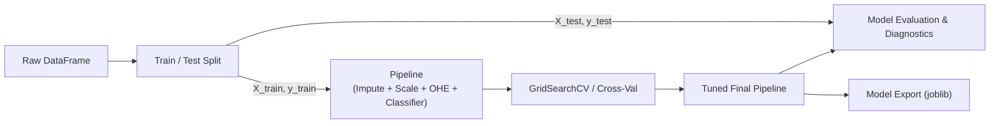

# End-to-End Machine Learning Pipeline

!!! info "Superseded by a worked example"
    This script is a compact template on synthetic data. The lifecycle chapter builds a complete project on real data, with the split, baselines, evaluation, packaging, monitoring and reproducibility done properly: start at [Problem Framing](../lifecycle/01-problem-framing.ipynb).


A complete, production-grade template for building a tabular classification model using Scikit-learn. Students can copy this template as the gold standard starting point for course projects.

---

## 🏗️ Architecture Blueprint



---

## 💻 Full Runnable Script

```python
"""
End-to-End Tabular Machine Learning Pipeline
Course: Machine Learning Practice (MLP)
"""

import numpy as np
import pandas as pd
from sklearn.datasets import make_classification
from sklearn.model_selection import train_test_split, GridSearchCV, StratifiedKFold
from sklearn.compose import ColumnTransformer
from sklearn.pipeline import Pipeline
from sklearn.impute import SimpleImputer
from sklearn.preprocessing import StandardScaler, OneHotEncoder
from sklearn.ensemble import RandomForestClassifier
from sklearn.metrics import classification_report, roc_auc_score, confusion_matrix
import joblib

# -------------------------------------------------------------
# 1. GENERATE REPRODUCIBLE DEMO DATASET
# -------------------------------------------------------------
print("--> Generating synthetic dataset...")
X_raw, y_raw = make_classification(
    n_samples=2000,
    n_features=6,
    n_informative=4,
    n_redundant=2,
    weights=[0.7, 0.3], # 70/30 class imbalance
    random_state=42
)

# Package into a realistic DataFrame with mixed numerical & categorical columns
df = pd.DataFrame(X_raw, columns=[f"num_{i}" for i in range(6)])
df["category_city"] = np.random.choice(["Paris", "London", "Tokyo", "New York"], size=len(df))
df["category_tier"] = np.random.choice(["Bronze", "Silver", "Gold"], size=len(df))
df["target"] = y_raw

# Inject occasional missing values
df.loc[df.sample(frac=0.03, random_state=1).index, "num_0"] = np.nan
df.loc[df.sample(frac=0.02, random_state=2).index, "category_city"] = np.nan

# -------------------------------------------------------------
# 2. FEATURE / TARGET EXTRACTION & TRAIN-TEST SPLIT
# -------------------------------------------------------------
X = df.drop(columns=["target"])
y = df["target"]

X_train, X_test, y_train, y_test = train_test_split(
    X, y,
    test_size=0.2,
    random_state=42,
    stratify=y
)
print(f"Train samples: {len(X_train)} | Test samples: {len(X_test)}")

# -------------------------------------------------------------
# 3. PREPROCESSING PIPELINES
# -------------------------------------------------------------
num_cols = ["num_0", "num_1", "num_2", "num_3", "num_4", "num_5"]
cat_cols = ["category_city", "category_tier"]

num_transformer = Pipeline(steps=[
    ("imputer", SimpleImputer(strategy="median")),
    ("scaler", StandardScaler())
])

cat_transformer = Pipeline(steps=[
    ("imputer", SimpleImputer(strategy="most_frequent")),
    ("encoder", OneHotEncoder(handle_unknown="ignore", sparse_output=False))
])

preprocessor = ColumnTransformer(
    transformers=[
        ("num", num_transformer, num_cols),
        ("cat", cat_transformer, cat_cols)
    ]
)

# -------------------------------------------------------------
# 4. FULL PIPELINE & HYPERPARAMETER TUNING
# -------------------------------------------------------------
full_pipeline = Pipeline(steps=[
    ("preprocessor", preprocessor),
    ("classifier", RandomForestClassifier(random_state=42, class_weight="balanced"))
])

param_grid = {
    "classifier__n_estimators": [100, 200],
    "classifier__max_depth": [5, 10, None],
    "classifier__min_samples_split": [2, 5]
}

cv_strategy = StratifiedKFold(n_splits=5, shuffle=True, random_state=42)

grid_search = GridSearchCV(
    estimator=full_pipeline,
    param_grid=param_grid,
    cv=cv_strategy,
    scoring="roc_auc",
    n_jobs=-1
)

print("--> Tuning hyperparameters with 5-Fold Cross Validation...")
grid_search.fit(X_train, y_train)

best_model = grid_search.best_estimator_
print(f"Best CV ROC-AUC: {grid_search.best_score_:.4f}")
print(f"Best Parameters: {grid_search.best_params_}")

# -------------------------------------------------------------
# 5. FINAL TEST EVALUATION
# -------------------------------------------------------------
y_pred = best_model.predict(X_test)
y_proba = best_model.predict_proba(X_test)[:, 1]

test_roc_auc = roc_auc_score(y_test, y_proba)
print("\n=== Test Set Performance ===")
print(f"Test ROC-AUC: {test_roc_auc:.4f}\n")
print(classification_report(y_test, y_pred, target_names=["Class 0", "Class 1"]))

print("Confusion Matrix:")
print(confusion_matrix(y_test, y_pred))

# -------------------------------------------------------------
# 6. MODEL EXPORT & INFERENCE VERIFICATION
# -------------------------------------------------------------
model_filename = "best_classifier_pipeline.joblib"
joblib.dump(best_model, model_filename)
print(f"\n--> Model serialized to '{model_filename}'")

# Load model and run inference on raw, un-preprocessed incoming sample
loaded_model = joblib.load(model_filename)
new_sample = pd.DataFrame([{
    "num_0": 0.52,
    "num_1": -1.20,
    "num_2": 2.14,
    "num_3": 0.05,
    "num_4": -0.88,
    "num_5": 1.45,
    "category_city": "Tokyo",
    "category_tier": "Gold"
}])

prediction = loaded_model.predict(new_sample)[0]
confidence = loaded_model.predict_proba(new_sample)[0][prediction]
print(f"Inference result: Predicted class {prediction} (Confidence: {confidence:.2%})")
```
